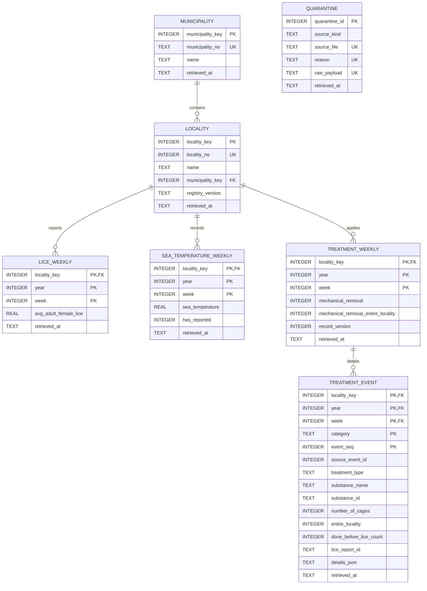

# Salmon Lice Exceedance Prediction

## The Question
We will investigate whether lagged sea temperature, temperature anomalies, delousing treatment history, and autoregressive lice counts can predict whether a farm's average adult female lice count exceeds statutory thresholds within the next 1–2 weeks. (Norwegian regulations define limits of 0.2 lice/fish during regional spring migration windows: Weeks 16–21 in south/central regions and Weeks 21–26 in the north, and 0.5 otherwise).

## Data Sources
- [BarentsWatch Fish Health API](docs/sources.md) (Data levert av BarentsWatch og Mattilsynet)

## How to run it
1. Clone the repository.
2. Create and activate a virtual environment:
   ```bash
   python -m venv .venv
   source .venv/Scripts/activate  # On Windows Git Bash: source .venv/Scripts/activate
   ```
3. Install dependencies:
   ```bash
   pip install -r requirements.txt
   ```
4. Copy `.env.example` to `.env` and fill in your API credentials (`BW_CLIENT_ID` = email:client_name).
5. Acquire raw data (raw data is not in git):
   - Either run `python src/ingest.py` (requires active API credentials in `.env`),
   - Or extract a provided `raw_data.tar.gz` archive: `tar -xzf raw_data.tar.gz -C data`.
6. Build database and run integrity checks (M2):
   ```bash
   python src/load.py
   python src/checks.py
   ```

## Repository Structure
```
salmon-lice-pipeline/
├── README.md               <- Project description and data model documentation
├── .gitignore              <- Ignores credentials, virtualenv, raw data and *.db
├── requirements.txt        <- Minimal dependencies (requests, python-dotenv)
├── config/
│   └── cohort.txt          <- Selected cohort of 40 active reporting localities
├── sql/
│   ├── schema.sql          <- 7 STRICT tables (entities, events, quarantine)
│   └── queries/
│       └── lice_by_temperature_band.sql <- Analytical query on lice exceedance
├── src/
│   ├── api_client.py       <- OAuth2 token manager and resilient HTTP request layer
│   ├── select_cohort.py    <- Filters active localities across Norway
│   ├── ingest.py           <- Lands raw JSON with UTC timestamps and xb mode
│   ├── explore_raw.py      <- Read-only inspection testing key schema assumptions
│   ├── db.py               <- connect() setting PRAGMA foreign_keys = ON & helpers
│   ├── load.py             <- Idempotent, atomic transaction loader into SQLite
│   └── checks.py           <- Automated integrity checks on temporary DB copy
└── docs/
    └── sources.md          <- 4 provenance cards with retrieval timestamps
```

---

## Data Model (M2)

### 6.1 Entity-Relationship (ER) Diagram


### 6.2 The Grain of Every Table
- **`municipality`**: One row means one Norwegian administrative municipality.
- **`locality`**: One row means one fish farm production site registered with Mattilsynet / BarentsWatch.
- **`lice_weekly`**: One row means one locality's reported average adult female lice count for a specific year and calendar week.
- **`sea_temperature_weekly`**: One row means one locality's sea temperature observation status and measurement for a specific year and calendar week.
- **`treatment_weekly`**: One row means one locality's delousing treatment flags and submission version for a specific year and calendar week.
- **`treatment_event`**: One row means one individual treatment intervention within a locality's weekly report, identified by category and item sequence.
- **`quarantine`**: One row means one malformed, unparseable, or orphaned record that could not be loaded into the core relational schema.

### 6.3 Decisions and Findings
- **Re-fetched copies**: M1 was run twice, so all 200 (locality, year) pairs exist as two files per folder with different `retrieved_at` values. The loader keeps the latest retrieval per key; 26,337 duplicate rows were collapsed.
- **Keys**: Verified empirically via `src/explore_raw.py` across 1,204 landed raw files. The natural key `locality_no` is unique across all files with zero naming drift (`src/explore_raw.py`). `municipality_no` was checked separately over every landed `data/raw/localities` file: it identifies one municipality (371 numbers, matching the `municipality` table), but one number, 5054, appears with two spellings that differ only in letter case ("INDRE FOSEN" and "Indre Fosen"). In the time-series files, `(locality_key, year, week)` exhibited zero duplicate weeks per file, confirming it as the natural composite event key. For nested treatment items, medicinal treatments lack an external identifier in the API payload, so items are uniquely identified by composite key `(locality_key, year, week, category, event_seq)`, with the full payload preserved in `details_json`.
- **Missing values**: In `sea_temperature_weekly`, 3,234 records have `hasReported == false` and `seaTemperature == None`. These are loaded as `has_reported = 0` and `sea_temperature = NULL` rather than `0.0`, ensuring temperature aggregations are not corrupted. In `lice_weekly`, the API returns only weeks for which a lice count was reported; a week that is absent means "not reported", and no placeholder rows are created. 0 nulls or non-numeric values were present in the landed data. The loader converts any non-numeric value in a numeric column to NULL and counts it (`values cleaned` in the run summary); in the current data this count is 0. The most recent weeks are placeholders: the data was retrieved on 2026-10-10 (week 41), the latest lice week in the database is 2026 week 41, and `sea_temperature_weekly` holds `has_reported = 0` rows for all 40 cohort localities in 2026 weeks 42-53 (480 rows), i.e. weeks that had not happened yet.
- **Unknown references**: Any record referencing a `locality_no` absent from `locality` is automatically quarantined into `quarantine` rather than crashing or being silently dropped (0 orphans were found in the cohort).
- **Change over time**: Entity attributes (locality names, registry versions, municipalities) follow a Type 1 policy: the record from the most recent `retrieved_at` timestamp wins (`ON CONFLICT ... DO UPDATE WHERE excluded.retrieved_at > ...`). Newly added entities are highlighted in the loader summary.
- **Known issues**:
  - Outliers in temperature: The raw dataset contains extreme sensor / manual entry artifacts (e.g., 35.0 °C and 197.0 °C). In strict accordance with M2 scope, raw values are loaded as recorded; outlier treatment is deferred to M3 cleaning.
  - Week 53: only 2026 reaches week 53 in the landed data (2022-2025 end at week 52). 2026 has 53 ISO weeks, and its week 53 rows are future placeholders (`has_reported = 0`). Handled by `CHECK (week BETWEEN 1 AND 53)`.
  - Empty categories: `cleanerFishTreatments` currently contains 0 items across the cohort dataset.
  - Municipality spelling: number 5054 appears as "INDRE FOSEN" and "Indre Fosen" within the same retrieval. The Type 1 rule keeps the spelling of the most recently retrieved locality row; on a tie, the first one in `locality_no` order. Not normalised in M2; deferred to M3.
  - Quarantine is append-only: a record quarantined in one run stays there even if a later run loads it successfully. No clean-up in M2.
- **Load safety**: The whole load runs in one transaction (`with con:`), and all validation happens before the first write. `src/checks.py` proves the two behaviours on a temporary copy. Idempotence: load again and compare the row count and a SHA-256 hash of every row of every table before and after. Atomicity: load into an empty database, raise a failure after 1,000 rows, and compare row counts before and after (unchanged). Two kinds of bad input behave differently. A failure while writing rolls back the whole run. A corrupted raw file or record is not fatal: it is written to `quarantine`, counted in the run summary, and the rest loads. We checked this by truncating one raw file in a copy: the summary showed "files skipped (unreadable): 1" and `quarantine` +1, all other tables unchanged.

### 6.4 Analytical Query
**File**: [`sql/queries/lice_by_temperature_band.sql`](sql/queries/lice_by_temperature_band.sql)

```sql
-- Question: How does the proportion of reporting weeks with average adult female lice exceeding a 
--           fixed analytical threshold of 0.2 (not the legal limit, which is 0.5 outside the spring windows)
--           vary across 2 °C sea temperature bands?
-- Result grain: One row per 2 °C sea temperature band.
-- Why aggregation is correct at this grain:
--   Readings from lice_weekly and sea_temperature_weekly are joined 1-to-1 on (locality_key, year, week),
--   so no join fan-out or Cartesian multiplication occurs. Rows are aggregated into discrete 2 °C bands.
--   Unreported weeks (has_reported = 0) and missing values (NULL) are excluded so AVG and SUM reflect true measurements.

SELECT
    CAST(FLOOR(t.sea_temperature / 2.0) * 2 AS INTEGER) || ' to ' ||
    CAST(FLOOR(t.sea_temperature / 2.0) * 2 + 2 AS INTEGER) || ' °C' AS temperature_band,
    COUNT(*) AS total_reporting_weeks,
    SUM(CASE WHEN l.avg_adult_female_lice >= 0.2 THEN 1 ELSE 0 END) AS exceedance_weeks,
    ROUND(100.0 * SUM(CASE WHEN l.avg_adult_female_lice >= 0.2 THEN 1 ELSE 0 END) / COUNT(*), 2) AS exceedance_rate_pct,
    ROUND(AVG(l.avg_adult_female_lice), 3) AS mean_avg_female_lice
FROM lice_weekly l
JOIN sea_temperature_weekly t
    ON l.locality_key = t.locality_key
    AND l.year = t.year
    AND l.week = t.week
WHERE t.has_reported = 1
  AND t.sea_temperature IS NOT NULL
  AND l.avg_adult_female_lice IS NOT NULL
GROUP BY FLOOR(t.sea_temperature / 2.0)
ORDER BY FLOOR(t.sea_temperature / 2.0);
```

#### Query Output
| Temperature Band | Total Weeks | Exceedance Weeks (≥0.2) | Exceedance Rate (%) | Mean Avg Female Lice |
|:---|:---|:---|:---|:---|
| 0 to 2 °C | 1 | 0 | 0.00% | 0.000 |
| 2 to 4 °C | 209 | 54 | 25.84% | 0.125 |
| 4 to 6 °C | 1,201 | 360 | 29.98% | 0.155 |
| 6 to 8 °C | 1,527 | 302 | 19.78% | 0.120 |
| 8 to 10 °C | 1,099 | 233 | 21.20% | 0.116 |
| 10 to 12 °C | 1,027 | 262 | 25.51% | 0.143 |
| 12 to 14 °C | 1,025 | 325 | 31.71% | 0.184 |
| 14 to 16 °C | 653 | 201 | 30.78% | 0.185 |
| 16 to 18 °C | 188 | 47 | 25.00% | 0.163 |
| 18 to 20 °C | 16 | 1 | 6.25% | 0.079 |
| 20 to 22 °C | 2 | 1 | 50.00% | 0.225 |
| 22 to 24 °C | 1 | 0 | 0.00% | 0.160 |
| 34 to 36 °C | 1 | 0 | 0.00% | 0.070 |
| 196 to 198 °C | 1 | 0 | 0.00% | 0.080 |

---

## Status
M2 — schema and load complete

## Team
- Çağatay Oruk (GitHub: se-230717041)
- Mehmet Egemen Karagöz (GitHub: se-230717063)
