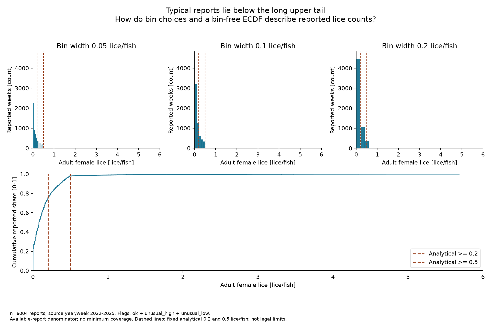
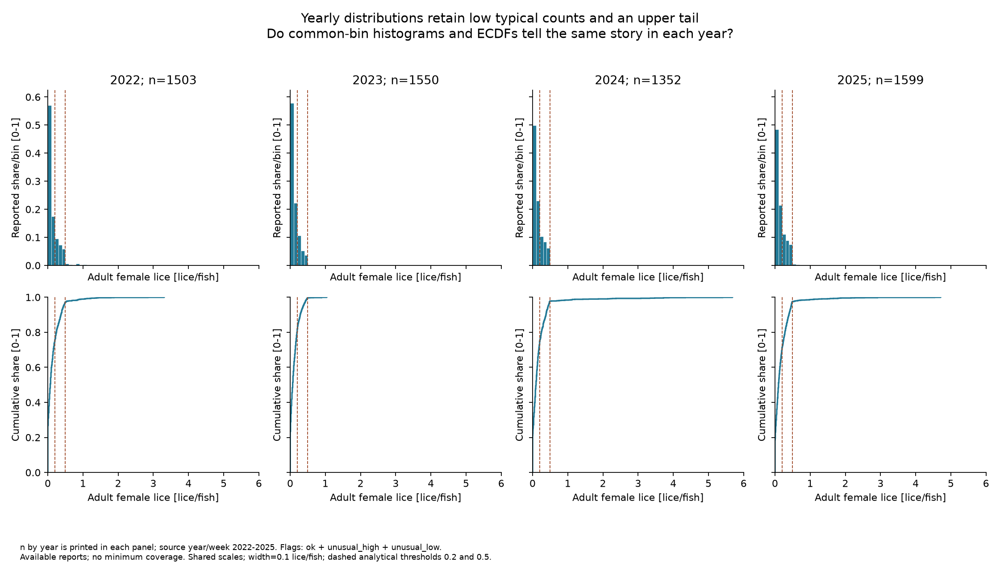
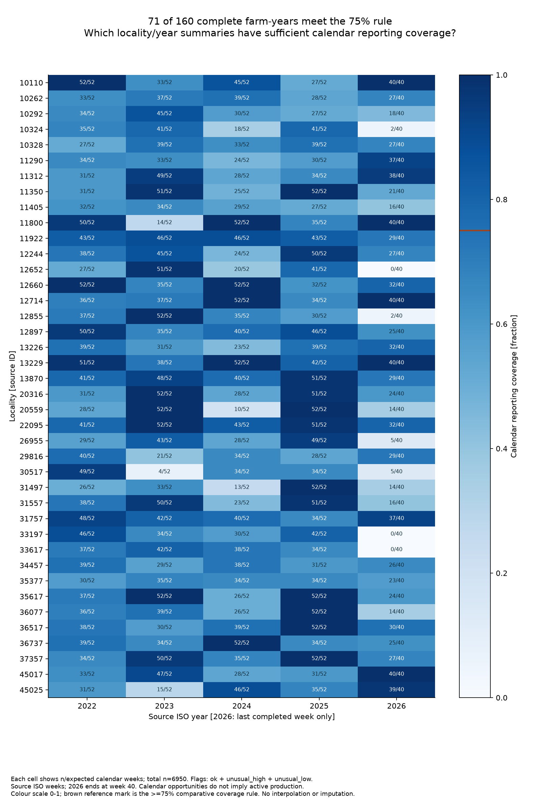
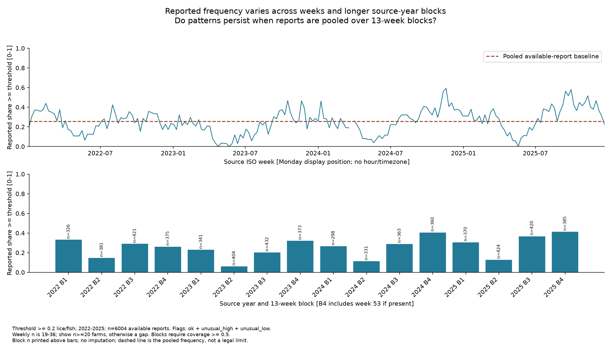
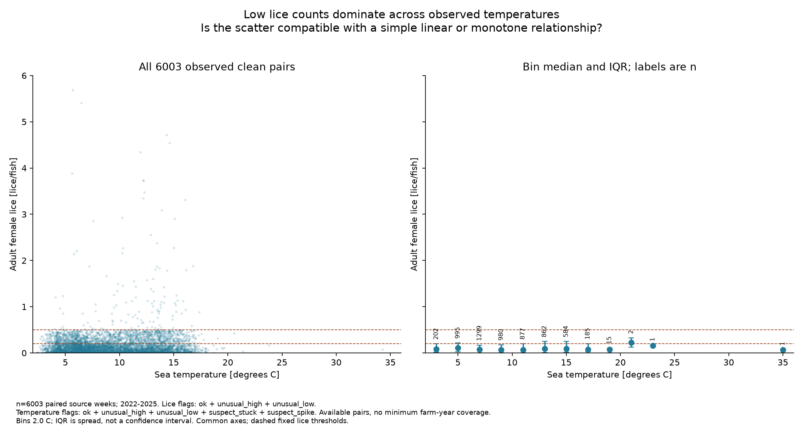
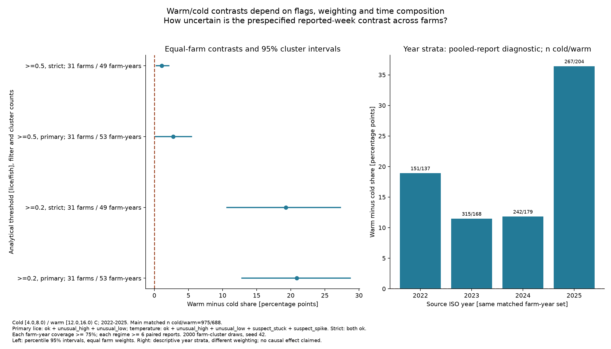

# Exploratory Analysis - Salmon Lice Pipeline

> Completed M4 exploration by Cagatay Oruk and Mehmet Egemen Karagoz.
> Figures and statistics come from the executed notebook; submission tagging awaits instruction.

## 1. Summary

We ask how often reported cohort weeks reach fixed lice thresholds and how summaries,
coverage, flags and seasonal composition change the answer. In 2022-2025, 1,540/6,004
reports reach 0.2 lice/fish; primary raw/clean results agree but strict filtering changes
the denominator and rate. Pooled temperature/lice correlations are weak, while a
prespecified warm-minus-cold comparison averages +20.87 percentage points across
31 matched farms, with a nominal farm-cluster 95% interval of +12.85 to +28.70.
The contrast remains exploratory because narrow-period overlap is sparse and farms
share time and environmental conditions. We establish neither a causal temperature
effect, farm-specific legal compliance nor predictive performance. No new measurement
cleaning defect was found; since M3, attribution wording was simplified without changing
measurement values, flags or mapping decisions.

## 2. Raw versus cleaned

**Question:** among the selected cohort's reported weeks in complete source years,
what share has average adult-female lice **greater than or equal to** a fixed threshold?
The population is the 40 committed cohort localities, not all 2,710 registry entries.
The primary period is 2022-2025; 2026 is not a complete annual comparison period.

Both raw and clean estimates use observed reports as their denominator. Missing weeks
are not counted as clean weeks or as zero lice. There is no minimum farm-year coverage
for this pooled descriptive number; section 4 shows the consequences of adding one.
The primary clean filter retains `ok`, `unusual_high`, `unusual_low`; the strict
sensitivity uses `ok` only. Retained extremes can be genuine infestations, so they
are not automatically omitted from the headline descriptive frequency.

The following equivalent queries state the complete estimand explicitly; all values
are bound parameters, including JSON arrays of cohort IDs and accepted flags. The
executed reusable version is [m4_cagatay_key_number.sql](../sql/queries/m4_cagatay_key_number.sql),
which also computes raw values on exactly the strict-clean accepted keys.

Raw query: no M2 flags exist; all non-NULL reported lice values in the cohort/period.

```sql
SELECT COUNT(r.avg_adult_female_lice) AS n,
       SUM(CASE WHEN r.avg_adult_female_lice >= :threshold THEN 1 ELSE 0 END) AS reaching,
       AVG(CASE WHEN r.avg_adult_female_lice IS NOT NULL
                THEN CASE WHEN r.avg_adult_female_lice >= :threshold THEN 1.0 ELSE 0.0 END END) AS share
FROM lice_weekly r
JOIN locality l USING (locality_key)
WHERE l.locality_no IN (SELECT value FROM json_each(:cohort_json))
  AND r.year BETWEEN :start_year AND :end_year;
```

Clean query: accepted flags are explicitly supplied through `:flags_json`.

```sql
SELECT COUNT(c.avg_adult_female_lice) AS n,
       SUM(CASE WHEN c.avg_adult_female_lice >= :threshold THEN 1 ELSE 0 END) AS reaching,
       AVG(CASE WHEN c.avg_adult_female_lice IS NOT NULL
                THEN CASE WHEN c.avg_adult_female_lice >= :threshold THEN 1.0 ELSE 0.0 END END) AS share
FROM lice_weekly_clean c
JOIN locality l USING (locality_key)
WHERE l.locality_no IN (SELECT value FROM json_each(:cohort_json))
  AND c.year BETWEEN :start_year AND :end_year
  AND c.avg_adult_female_lice_flag IN (SELECT value FROM json_each(:flags_json));
```

Bindings: `start_year=2022`, `end_year=2025`, `threshold=0.2` or `0.5`;
`cohort_json` is the JSON encoding of `config/cohort.txt`. Primary `flags_json` is
`["ok","unusual_high","unusual_low"]`; strict is `["ok"]`.

| Threshold [lice/fish] | Layer / filter | n reports | Reaching threshold | Share |
|---:|---|---:|---:|---:|
| 0.2 | M2 raw, no flags | 6,004 | 1,540 | 25.6496% |
| 0.2 | Clean primary | 6,004 | 1,540 | 25.6496% |
| 0.2 | Clean strict | 5,881 | 1,417 | 24.0945% |
| 0.2 | Raw values on strict-clean keys | 5,881 | 1,417 | 24.0945% |
| 0.5 | M2 raw, no flags | 6,004 | 120 | 1.9987% |
| 0.5 | Clean primary | 6,004 | 120 | 1.9987% |
| 0.5 | Clean strict | 5,881 | 44 | 0.7482% |
| 0.5 | Raw values on strict-clean keys | 5,881 | 44 | 0.7482% |

The primary raw/clean difference is zero: no lice measurement was numerically rejected
in this period, and the primary filter retains flagged high values. The strict-filter
difference is a selection change, as the raw-on-strict-keys check reproduces it exactly;
123 reports, including 76 of the 120 reports reaching 0.5, are excluded. Rejecting the
196.18 C temperature does not alter this lice-only denominator because no temperature
join is part of this question; its consequence belongs to the later relationship analysis.

## 3. The question and its summary

The project ultimately asks whether future lice-limit exceedance can be predicted.
M4 addresses a descriptive precursor: **how often do reported farm weeks reach fixed
lice-count thresholds, and how do coverage and distributional choices change that answer?**
The primary summary is a share because the question concerns frequency, rather than
the average intensity of lice burden. The median answers a different question, the
typical reported count, and p95 describes the high-count tail. Neither is substituted
for the frequency merely because it gives a more striking ranking.

Comparative farm summaries include only farm-years with at least 75% of calendar weeks
reported: at least 39 of 52 in each complete study year. This leaves 3,306 reports,
71 farm-years and 37 farms. Full unrestricted rankings for all 40 farms, qualified
rankings and n for every estimate are printed in the executed notebook and saved in
[m4_cagatay_results.json](evidence/m4_cagatay_results.json). Ties receive competition
ranks rather than arbitrary ID-order ranks. Pooled farm ranks can still reflect the
different years that qualify for each farm; Egemen must check composition before
interpreting between-farm differences; that check is reported in section 7.

| Ranking question | Example farm | n qualified reports | Threshold share | Median [lice/fish] | p95 [lice/fish] | Share rank / median rank / p95 rank |
|---|---:|---:|---:|---:|---:|---|
| Frequent reports >=0.2 | 11800 | 102 | 57.8431% | 0.2300 | 0.4600 | 1 / 1 / 13 |
| Frequent reports >=0.2 | 36737 | 91 | 52.7473% | 0.2100 | 0.4500 | 2 / 2 / 16 |
| Frequent reports >=0.5 | 45025 | 46 | 13.0435% | 0.0000 | 3.4765 | 1 / 33 / 1 |
| Frequent reports >=0.5 | 12897 | 136 | 11.0294% | 0.1750 | 0.8600 | 2 / 5 / 3 |

Share and median ranks differ for 32/37 qualified farms at threshold 0.2 and 37/37
at 0.5, with the stated tie convention. Farm 45025 illustrates why: its qualified
reports have a zero median but a high tail, so a typical-week question and a severe-week
frequency question identify different features. These are conditional descriptions
of observed periods, not a stable ranking of intrinsic farm risk. No confidence interval
or hypothesis test is claimed for this stage's descriptive ranking.

## 4. What the data is made of

### Shape



The 6,004 primary-filter reports have median 0.0800, mean 0.1479, p95 0.4400 and
maximum 5.6833 lice/fish; 1,339 reports (22.30%) are exactly zero. The distribution has
a strong low-count concentration and a long right tail. That makes the mean an
incomplete answer to both the typical-report and threshold-frequency questions.
We compare histogram widths 0.05, 0.1 and 0.2 lice/fish. The selected 0.1 spacing
separates increments around the 0.2 and 0.5 thresholds without the especially coarse
merging of 0.2-wide bins or the jagged detail of 0.05-wide bins. The ECDF provides a
bin-free check; no log transform of zeros or smoothing is used.



| Year | n reports | Median [lice/fish] | p95 [lice/fish] |
|---:|---:|---:|---:|
| 2022 | 1,503 | 0.0700 | 0.4500 |
| 2023 | 1,550 | 0.0700 | 0.3700 |
| 2024 | 1,352 | 0.1000 | 0.4445 |
| 2025 | 1,599 | 0.1000 | 0.4600 |

Yearly panels use identical axes and 0.1-wide bins. Histogram heights are fractions
of each year's n, while ECDFs show cumulative report shares. The lower typical counts
and upper tail occur in each year; differences between yearly curves may reflect
composition and reporting as well as conditions. These shapes use all available
primary-filter reports with no minimum coverage, making that denominator explicit.

### Coverage rule and sensitivity



The notebook prints a complete 40-by-5 farm/year table, including zero-report cells.
Calendar opportunities are a transparent common denominator, not a claim that stock
was present or reporting legally required in every week. No missing week is inserted
into the database. For 2026, the latest complete week at the October 10 retrieval is
week 40, giving 40 calendar opportunities per farm; the incomplete week 41 is excluded.
The source-clock convention and edge/calendar checks are discussed in section 5.

| Year | n reported lice weeks | Calendar opportunities | Coverage | Farm-years meeting 75% |
|---:|---:|---:|---:|---:|
| 2022 | 1,503 | 2,080 | 72.26% | 15/40 |
| 2023 | 1,550 | 2,080 | 74.52% | 21/40 |
| 2024 | 1,352 | 2,080 | 65.00% | 14/40 |
| 2025 | 1,599 | 2,080 | 76.88% | 21/40 |
| 2026, weeks 1-40 only | 946 | 1,600 | 59.13% | 13/40 |

The 75% rule demands three quarters of the full annual reporting grid for comparative
farm summaries. It is a documented pragmatic screen, not a guarantee of unbiased
coverage: the missing quarter can still be seasonally concentrated. We therefore
show both versions and do not silently discard the other 89 complete farm-years.

| Threshold | Coverage rule, primary flags | Farm-years | n reports | Reaching | Share |
|---:|---|---:|---:|---:|---:|
| 0.2 | Available reports, no minimum | 160 | 6,004 | 1,540 | 25.6496% |
| 0.2 | At least 75% per farm-year | 71 | 3,306 | 879 | 26.5880% |
| 0.5 | Available reports, no minimum | 160 | 6,004 | 120 | 1.9987% |
| 0.5 | At least 75% per farm-year | 71 | 3,306 | 61 | 1.8451% |

The effect is not simply that a stricter rule always raises the rate: it raises the
0.2 share and lowers the 0.5 share in this snapshot. This demonstrates estimand and
composition sensitivity, not a causal coverage effect. Filter sensitivity is shown
separately in section 2. Every estimate identifies its threshold, flag filter, period
and n; neither sample size nor a high apparent reporting share establishes national
representativeness for this deliberately selected cohort.

## 5. Time



**Clock:** stored source year/week, displayed at ISO Mondays, not UTC measurement
hours. [BarentsWatch](https://www.barentswatch.no/veiledning/fiskehelse-forklaring-og-bruksanvisning/)
and [Mattilsynet](https://www.mattilsynet.no/fisk-og-akvakultur/fiskesykdommer/lakselus/veiledning-rapportering-av-lakselus)
confirm weekly reports due the following Tuesday. Neither consulted page explicitly
defines ISO 8601; that remains our documented calendar convention. Retrieval time is
provenance and no timezone conversion is invented for week labels.

Each study year has source weeks 1-52. First/last-week report counts are respectively
29/30, 31/28, 27/30 and 29/27 for 2022-2025, out of 40 possible cohort sites. Thus
calendar-complete weeks still have incomplete farm reporting. The latest source week,
2026-W41, was in progress at retrieval and is excluded from full-year analyses; the
2026 coverage inventory stops at week 40. We retain rather than fill missing periods.

The weekly line requires at least 20 farms: 207/208 weeks qualify and one is a gap.
The four annual 13-week blocks require 50% of their 520 calendar opportunities; all
16 qualify, with n=298-432. These are source-week blocks, not Gregorian quarters.
At >=0.2, block-2 frequencies range from 5.94% to 14.70%, whereas the 2024/2025 final
blocks reach 40.56%/41.30%. Seasonal reporting and composition prevent interpreting
these differences as changes in an otherwise fixed population.

[Mattilsynet's spring announcement](https://kommunikasjon.ntb.no/pressemelding/14466857/lavere-lakselusgrense-om-varen-og-telling-av-lakselus-i-alle-merder?publisherId=10773547)
documents windows 16-21 and 21-26 in different regions. Pooling the whole cohort merely
as calendar annotations gives >=0.2 shares 53/699 (7.58%) and 79/769 (10.27%); windows
overlap in week 21. We assign no farm-region legal regime, and these are not violation
rates. [Enforcement guidance](https://www.mattilsynet.no/fisk-og-akvakultur/fiskesykdommer/lakselus/lavere-lusegrense-om-varen)
also involves counting uncertainty and report sequences. Source details are recorded
in [calendar evidence](m4_calendar_sources.md).

## 6. Relationships



The one-to-one join yields 6,003 clean paired weeks, compared with 6,004 raw pairs;
rejecting the extreme temperature removes one pair. The scatter is plotted before
coefficients. Two-degree bins show medians and IQR spread, with n even for thin bins;
IQR bars are not confidence intervals. There is no minimum annual coverage for this
descriptive paired-report relationship. Primary lice flags retain unusual values;
primary temperatures additionally retain suspect_stuck/spike. Strict uses ok only.

| Configuration | n pairs | Pearson r | Spearman rho |
|---|---:|---:|---:|
| Primary clean | 6,003 | 0.0636 | 0.0085 |
| Raw, including extreme temperature | 6,004 | 0.0511 | 0.0084 |
| Strict flags on both variables | 5,855 | 0.0368 | -0.0075 |
| Remove upper 1% lice tail | 5,942 | 0.0390 | -0.0039 |
| Centred within farm-year | 6,003 | 0.1024 | 0.0960 |
| Centred within year-week | 6,003 | -0.0105 | -0.0330 |

Spearman's near-zero pooled value better reflects the largely flat typical-count
picture than interpreting the small positive Pearson coefficient as a strong linear
relationship. Neither coefficient adequately describes all tails and seasons. The
preconfigured 99th-percentile sensitivity removes 61 reports above 1.0094 lice/fish
only from the diagnostic, never from M3. Across all 40 leave-one-farm-out checks,
Pearson ranges 0.0498-0.0823 and Spearman -0.0066-0.0246: no single farm creates a
large pooled association. Block-1 correlations are negative, while block 3 is positive.
Centred correlations describe residual observations, not causal partial effects;
the same-year/week diagnostic weakens the pooled association further. We report no
p-values treating thousands of repeated weeks as independent farms.

## 7. The comparison



Before computing the comparison, the first-cell parameters fixed cold as 4<=T<8 C,
warm as 12<=T<16 C and >=0.2 as primary; >=0.5 and strict flags are sensitivities.
Farm-years need 75% annual lice coverage and at least six paired reports per regime.
Compute warm-minus-cold frequency within each qualifying farm-year, average its years
within each farm, then average farms equally. The 2,000 percentile bootstrap draws
(seed 42) resample whole farms with all their paired years. They do not resample 53
farm-years as if independent, or thousands of individual weeks.

| Threshold | Filter | Farms / paired farm-years | n cold / warm | Equal-farm difference [pp] | Nominal 95% interval [pp] |
|---:|---|---|---|---:|---|
| 0.2 | Primary | 31 / 53 | 975 / 688 | +20.87 | +12.85 to +28.70 |
| 0.2 | Strict | 31 / 49 | 929 / 609 | +19.27 | +10.63 to +27.30 |
| 0.5 | Primary | 31 / 53 | 975 / 688 | +2.78 | +0.13 to +5.43 |
| 0.5 | Strict | 31 / 49 | 929 / 609 | +1.08 | +0.27 to +2.10 |

Primary pooled shares on the matched rows are 208/975=21.33% cold and
292/688=42.44% warm: their +21.11 pp report-weighted difference differs from the
equal-farm +20.87 pp estimand. Before requiring regime matching, the qualified-year
pooled difference is +17.56 pp, so composition matters. Strict filtering also changes
annual eligibility and leaves 49 paired farm-years; it is not a same-population
numeric correction.

| Time composition, primary >=0.2 | n cold / warm | Pooled difference [pp] |
|---|---|---:|
| 2022 | 151 / 137 | +18.90 |
| 2023 | 315 / 168 | +11.47 |
| 2024 | 242 / 179 | +11.81 |
| 2025 | 267 / 204 | +36.41 |
| Block 1 | 544 / 0 | Not identifiable |
| Block 2 | 306 / 81 | +20.23 |
| Block 3 | 0 / 489 | Not identifiable |
| Block 4 | 125 / 118 | +8.45 |

There is no direction reversal in the supported year/block pooled strata, so this
check does not demonstrate Simpson's paradox. It does expose severe seasonal
separation: block 1 has no warm reports and block 3 no cold reports. Only one same
year/week has at least three farms per regime, so its +25 pp diagnostic cannot support
a stable same-period conclusion. Within-farm/year/block overlap exists in 27 thin
strata with at least two reports per regime; their descriptive mean is +17.31 pp, not
a fully controlled causal estimate. The nominal farm-cluster interval ignores shared
spatial/weather dependence and is conditional on the selected regimes and reports.
It is neither multiplicity-adjusted nor evidence of future predictive accuracy.

## 8. Findings

| ID | Finding | Evidence | Label | What would change it | Explored by |
|---|---|---|---|---|---|
| F-01 | Primary raw and clean lice frequencies agree at both fixed thresholds in 2022-2025 | Section 2; key-number SQL | Confirmed by arithmetic within this extract | Different values, period or accepted flags | Cagatay Oruk |
| F-02 | Excluding unusual lice reports lowers the 0.5 reported-week share from 1.9987% to 0.7482% | Section 2; raw-matched-key check | Confirmed filter/composition arithmetic | A different filter or source revision | Cagatay Oruk |
| F-03 | Typical-count and threshold-frequency farm rankings need not agree | Section 3; 45025 has median zero but highest qualified >=0.5 share | Exploratory | Common-period comparison, more years or coverage revision | Cagatay Oruk |
| F-04 | Only 71/160 complete farm-years meet 75% reporting coverage, and enforcing it changes threshold shares in different directions | Coverage table and figure | Confirmed arithmetic; broader interpretation exploratory | Another coverage threshold, production-status denominators or new data | Cagatay Oruk |
| F-05 | Reported lice counts show a low-count concentration and long upper tail in each complete year | Overall/yearly histogram and ECDF; n=6004 | Exploratory | New periods, an alternative cohort or source corrections | Cagatay Oruk |
| F-10 | Week/block frequency varies and current/edge coverage is incomplete | Time figure; 207/208 weekly points meet the rule | Exploratory | Additional completed periods or production-status denominators | Mehmet Egemen Karagoz |
| F-11 | Pooled temperature/lice correlations are weak and sensitive to conditioning | Relationship figure and coefficient table, n=6003 | Exploratory | Other periods, lags or a different within-group analysis | Mehmet Egemen Karagoz |
| F-12 | The prespecified matched warm/cold contrast is +20.87 pp with farm-cluster interval +12.85 to +28.70 | Comparison figure, 31 farms / 53 farm-years | Exploratory | Held-out data, regime choices, stronger dependence modelling | Mehmet Egemen Karagoz |
| F-13 | Same-period overlap is too sparse to separate temperature cleanly from seasonal composition | One common year/week; missing regimes in blocks 1 and 3 | Confirmed support counts; interpretation exploratory | More common-period overlap or a different study design | Mehmet Egemen Karagoz |

The [look log](evidence/m4_look_log.json) records **121 configuration looks**: 19
Cagatay, 6 calendar/time, 51 correlation/influence and 45 comparison/stratum entries.
The 45 include the comparison declaration, four threshold/filter intervals, 32 year/block
checks and eight overlap checks. The 40 leave-one-farm-out checks count separately.
These are not 121 independent hypotheses. The primary comparison was fixed in code
before calculating its outcome, after the preceding exploration; the intervals remain
exploratory rather than a discovery confirmed on unseen data.

### Back to cleaning

No new measurement-cleaning defect was found in either stage. Existing
high lice flags are deliberately retained, not errors to remove. Existing M3 coverage,
unknown reporting mechanisms and temperature suspicions remain limitations. A layout
issue found during figure review was corrected in plotting code, not in source data.
The later influence checks did not establish an additional faulty value requiring a
cleaning rule. This review is also recorded in the M3 issues register; no notebook
cell corrects data. Future confirmed corrections belong in clean.py and that register.

### Forward to modelling

M7 should test whether lagged lice and temperature improve on a seasonal/autoregressive
baseline using held-out future periods. Calendar-align lags rather than shift rows;
never turn missing reports into zeros. Handle thin farms and the nonrepresentative
cohort explicitly. Fit preprocessing only on training periods: M3's full-history
statistical flags can otherwise reveal future distributions. Treatment variables,
revised reports and intervention timing may be available after the outcome; establish
availability timestamps before using them. Check performance across years/farms and
do not treat this contemporaneous contrast as a forecasting result.

## 9. What we can't say

Results describe available cohort reports, not national prevalence or legal compliance.
Missing stock status, unknown reporting mechanisms, sparse seasonal overlap, retained
suspect measurements and latest-retrieval revisions limit interpretation. Weekly
temperature/lice pairs do not establish direction of causation; interventions can
follow lice increases. Farms share environmental conditions, weakening a simple
independent-cluster interpretation. No predictive model or held-out validation was
performed; the nominal intervals describe this conditional exploratory comparison.

### Full execution evidence

[Fresh-build verification](evidence/m4_verification.json) records exit code 0,
unchanged before/after contents of all 17 tables, two rejected write attempts through
the read-only connection, identical fresh/workspace results and identical SHA-256
digests for all six regenerated PNGs. The notebook is committed with actual Jupyter
outputs, and [the hash manifest](evidence/m4_readonly_hashes.json) records every table.
The [full results](evidence/m4_results.json) preserve every count, interval and diagnostic.
The historical Cagatay-named JSON paths remain compatibility aliases for existing links.

| Figure check | Overall shape | Yearly shape | Coverage |
|---|---|---|---|
| Finding title + question subtitle | Yes | Yes | Yes, 71/160 |
| Units / source-clock context / n / flag filter / coverage rule | Yes | Yes, n per panel | Yes, n/expected per cell |
| Zero-based bars / common scales | Counts start at zero; common histogram axes | Fractions start at zero; common axes by row | Common 0-1 colour scale |
| Missing periods not bridged / no dual y-axis | No temporal lines; no dual axis | Separate groups; no temporal interpolation | Zero coverage explicitly shown; no interpolation |
| Relevant reference | Analytical 0.2 and 0.5 | Analytical 0.2 and 0.5 | 75% reference on colour scale |

The three Egemen figures also pass: time uses a pooled reference and explicit gaps;
relationship panels share axes and mark analytical thresholds; comparison intervals
and bars use a zero reference. All include n, flags, units, clock/period and coverage
rules, with no dual y-axes. Comparison strata use different declared weights rather
than pretending they are replicas of the interval estimand.
