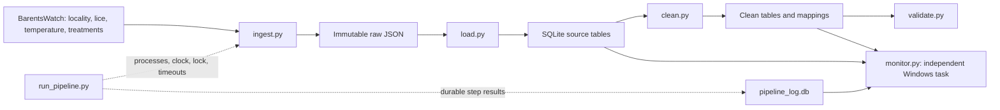

# Pipeline - Salmon Lice Exceedance Prediction

## 1. The graph



| Step | Input | Output | Rebuild from |
|---|---|---|---|
| ingest | Registered API client, fixed 40-farm cohort, UTC run clock | Original response bytes; success checkpoint | Source annual endpoints while history remains available |
| load | All landed JSON | Seven M2 STRICT tables | Local raw archive, no network |
| clean | M2 and reviewed mapping CSVs | Six clean tables and four mapping tables | M2 and committed rules/mappings |
| validate | Source and clean tables, run clock, load metrics | PASS/INFO/WARN/STOP output, exit 1 on STOP | Current database |
| runner | Step scripts and configuration | One row per attempted step in a separate STRICT log DB | Operational history cannot be rebuilt from measurement data |
| monitor | Read-only main DB and run log; independent clock | Four PASS/ALARM lines; exit 1 on any alarm | Current DB plus preserved operational log |

The main DB is `data/salmon_lice.db`. The independent `data/pipeline_log.db` must
not be deleted during backfills. Neither DB, credentials nor raw archives are in
Git. Per-step stdout/stderr is kept under `logs/<run_id>/`.

## 2. Design decisions

| Decision | Choice | Reason |
|---|---|---|
| Ingestion start/overlap | Every annual slice from 2022 to the run-clock year; record last complete retrieval | Annual endpoints do not provide a verified modification cursor. Full project-history overlap captures missed runs and old revisions without guessing a delay bound |
| Request bounds | One thread, 0.1 s pacing, bounded retries, Retry-After, 721-request ceiling | Provider requests single-thread batch downloads; oversized catch-up fails before partial execution |
| Loading | Replay all raw files with guarded upserts | Small local archive; simpler recovery than a processed-file manifest |
| Versions | Strictly newer `retrieved_at` wins, including treatment parent/list replacement | Re-reading old files cannot undo a newer record |
| Cleaning | Whole-history transactional rebuild | IQR, adjacent weeks and stuck sequences must not depend on batch boundaries |
| Clock | One UTC `--run-time` propagated to every subprocess | Same data/clock yields identical tables; wall time only supplies the default clock and log timestamps |
| Backfill | `run_pipeline.py --skip-ingest` with an explicit clock when reproducing an earlier decision date | Replays landed data and replaces clean rows without network or duplicate keys |
| Lock | Exclusive `os.open(O_CREAT | O_EXCL)`; removed in `finally` | Manual and scheduled invocations cannot overlap |
| Step isolation | `subprocess.run` using `sys.executable`; 30-minute timeout per step | First nonzero code stops subsequent steps; timeout is 124 |

### How late our data arrives

Run `python notebooks/profile_m5_delays.py`; the original baseline is preserved in
`docs/evidence/m5_delay_profile.json`. It compares each source week's Monday to
the raw filename's retrieval time and compares repeated observations of each key.

| Source | Original re-observed keys | Observed revisions | Maximum archive age |
|---|---:|---:|---:|
| Lice | 6,951 | 0 | 1,741 days |
| Temperature | 10,440 | 0 | 1,741 days |
| Treatments | 816 | 0 | 1,741 days |

These October 10 acquisitions cover only a short retrieval window. **Archive age
is not publication delay.** Zero observed revisions does not prove revisions
never occur. We therefore do not claim a safe narrow overlap. See
[the acquisition contract](m5_ingest_design.md) for the query/profile method and
source references. The original archive contains six valid empty annual lice
arrays and 76 empty annual treatment arrays; an individual empty array is not
automatically a broken response. Empty required locality/temperature feeds,
unexpected JSON and a wholly empty lice feed fail ingestion.

### Source memory and scaling

The archive establishes project coverage from 2022, not guaranteed perpetual API
retention. A historical endpoint error fails the run and leaves the checkpoint
unchanged. Full replay cannot restore a revision the provider no longer exposes.
There is no verified numeric retention promise in the consulted documentation.
The request ceiling currently permits 2027 at this cohort size and fails loudly
before an oversized later plan. Missing historical responses must be investigated,
not quietly replaced with a partial recent fetch.

The first complete manual live test took 633 seconds: ingestion 627, load 5,
clean 1. The source network dominates; this is a measurement, not a future runtime
guarantee. Local full reload was about 5 seconds. A linear 100-fold archive growth
could put it near eight minutes; benchmark again well before the 30-minute budget.
Full cleaning may change old statistical flags as history grows. Raw values and
the earlier `m3`/`m4` snapshots remain available for interpretation.

### Validation classifications and the 15 nonreporting farms

Historical missingness, reviewed suspect sequences, ambiguous substance code 0 and
unknown cage counts are INFO because they are documented M3 limitations rather
than new operational incidents. Values and quality flags are preserved.

The refreshed source explicitly says `has_reported=0` for the latest due week for
exactly the 15 farms with old lice/temperature observations. This does **not** prove
inactivity or legal compliance. Validation distinguishes a recently confirmed
nonreport from unexplained missingness: only a matching latest-due-week status
retrieved within 48 hours allows an INFO classification. Missing/old statuses and
unexplained stale values still WARN; either whole measured feed becoming older
than 21 days still WARNs regardless of those statuses. The monitor deliberately
continues to ALARM on old measured values for these farms. Thus INFO is not a claim
that the measurements became fresh. Tests cover a whole-feed stop and stale status.

Volume counts net new M2 keys against typical positive scheduled loads, excluding
the current run and initial bootstrap. Ten times typical WARNs. Zero keys normally
WARNs when the feed is unexpectedly stale; it is deliberately INFO between weekly
releases while the feed remains fresh or the source has explicitly confirmed
nonreporting. Revisions at existing keys are not labelled new rows.

## 3. Operations

From the activated project venv and repository root:

```bash
python src/run_pipeline.py
python src/run_pipeline.py --skip-ingest
python src/monitor.py
```

For a reproducible decision clock, add `--run-time 2026-11-23T12:00:00Z`; monitor
uses `--now` instead. An earlier clock reclassifies future observations in cleaning;
it does not retrieve a historical as-of source snapshot. Use the appropriate saved
raw archive if as-of revisions matter.

| Exit | Meaning |
|---:|---|
| 0 | All attempted pipeline steps succeeded; WARN/INFO can remain |
| Nonzero step code | First failed step's actual code; subsequent steps did not run |
| 1 | Typical validation STOP, monitor ALARM or infrastructure/source failure |
| 75 | Existing lock; no step ran |
| 124 | Timed-out step was terminated and logged |

Every attempted step has `run_id`, `run_time`, `step`, `started_at`, `finished_at`,
`exit_code`, `run_kind`, and JSON `detail`. `manual`, `scheduled` and `rebuild` are
distinct. Only a complete four-step successful scheduled run counts for scheduled
success/days. Tests use disposable logs under `tmp/m5`, never the submitted log.
`--skip-ingest` is a three-step rebuild and cannot conceal a stopped live ingestion.

On failure inspect the step output path in `detail`, correct the cause, then rerun.
Source and clean writes have their own transactions; there is no transaction across
four processes. A failed clean does not undo an earlier successfully committed
load. Its own clean writes roll back. Revised treatment source lists remove dependent
derived events within the load transaction so obsolete keys do not violate FKs;
the next clean step rebuilds that derived layer. Never analyse a run whose clean or
validation step failed. After power loss, inspect a leftover lock and PID before
removing the lock; do not delete a possibly active writer's lock blindly.

### Schedule on Cagatay's Windows computer

- Pipeline: **15:15 and 20:15 Europe/Istanbul**, `ops/task_scheduler.xml`.
- Independent monitor: **15:50 and 20:50**, `ops/monitor_scheduler.xml`.
- Full venv Python path and repository working directory are explicit.
- S4U runs without an interactive login. Wake and missed-start recovery are enabled;
  battery restrictions are disabled. Wake depends on the laptop's power support.
- Computer power and internet are necessary; physical attendance is not.
- Pipeline `.env` is resolved from the repository path. It is not committed.

The interval is operational polling of weekly reports, not new hourly measurements.
The [provider](https://developer.barentswatch.no/docs/fishhealth/) encourages
registered batch use with one download thread; no numeric quota was established.
Back off on throttling. Logs record UTC; Windows triggers use local UTC+3. Unequal
5-hour/19-hour planned gaps are accounted for by expected slots, not a 12-hour rule.

To reinstall tasks, run the corresponding `ops/register_*.ps1` with appropriate
Windows administrator permission. Do not re-register or update tasks while a run
is in progress. The exported XML files are actual registered definitions.

## 4. Evidence

### Run log snapshot - November 23, not the final submission summary

The query is committed as `sql/queries/m5_run_summary.sql`. Bind `:since` and
`:until` to the desired UTC window and `:local_offset` to `+3 hours`.
Current output for the November 23 window:

| run_kind | first_run UTC | last_run UTC | runs | local_days | failed_runs |
|---|---|---|---:|---:|---:|
| manual | 2026-11-23T11:47:23Z | 2026-11-23T11:47:23Z | 1 | 1 | 0 |
| scheduled | 2026-11-23T12:15:01Z | 2026-11-23T12:15:01Z | 1 | 1 | 0 |

The first actual scheduled pipeline completed all four steps. There is currently
**one day**, not seven days, of successful scheduled evidence. Actual rows are
in the separate run log; `docs/evidence/m5_operational_status.json` exports this
snapshot. Never backdate runs or relabel manual tests. November 23-29 covers seven
calendar dates if each date has a real successful run; it does not establish seven
elapsed 24-hour periods. That interpretation remains a grading risk.

### Six drills

| Drill | Completed evidence / current state |
|---|---|
| Wrong API credentials | Real token endpoint rejection with intentionally invalid environment credentials; runner exit 1; only ingest logged |
| Step failure | Load failure and a clean failure after 22,000 writes; exit 1; no later steps; all affected tables unchanged on disposable copies |
| Hang | Disposable load sleeps; short runner timeout produces 124 and a failed log row |
| Concurrent runs | First holds the lock; second exits 75 and adds no step |
| Real missed runs | Scheduled for November 24-25; recovery has not happened yet |
| Old file after newer data | Replaying fixed older raw cannot overwrite a newer corrected value |

`notebooks/check_m5_drills.py` writes `docs/evidence/m5_failure_drills.json`.
Hooks are off by default, require explicit `--drill-*`, and refuse production DBs.
`notebooks/check_m5_monitor.py` proves all four monitor checks can ALARM; its data
and scheduled rows are fixtures, explicitly labelled and separate from live logs.

### Controlled missed runs - planned, not completed evidence

The registered one-off XML definitions are `ops/drill_begin.xml`,
`ops/drill_resume.xml`, and `ops/drill_finish.xml`:

| Local time | Action |
|---|---|
| Nov 24, 19:55 | Capture before state, turn off missed-start catch-up, disable only the pipeline task |
| Nov 24, 20:15 | First deliberately missed pipeline slot; monitor remains enabled |
| Nov 25, 15:15 | Second deliberately missed slot |
| Nov 25, 19:55 | Re-enable pipeline without an immediate catch-up start |
| Nov 25, 20:15 | Scheduled full-history replay and normal load/clean/validate |
| Nov 25, 20:50 | Capture after state and restore normal missed-start catch-up |

Nov 24's afternoon and Nov 25's evening can still provide each day's evidence.
The laptop must execute the one-off controller tasks; a missed/late begin task
refuses to disable the pipeline outside its safe window. Resume always re-enables
the pipeline. Finish restores normal catch-up even if verification fails. If the
machine misses these controls, inspect results rather than claiming success.

Before/after captures use the **same 2026-W47 target period** and include weekly
status counts, measured lice rows and monitor output. Recovery additionally checks
every latest landed lice/temperature key, raw value and version against M2 and
requires a complete scheduled recovery run plus both actual missing slots in the
monitor's gap result. Zero new rows is reported honestly if the weekly source did
not change during the outage. Raw replay/checkpoint behaviour also has fixture
tests, which are not substituted for this real experiment.

Results go to ignored `output/m5_experiment/`; only a verified actual recovery
creates `docs/evidence/m5_missed_run_recovery.json`. After a failed capture rerun:

```bash
python notebooks/m5_missed_run_capture.py after
```

### Independent monitor snapshot and remaining risk

November 23's real read-only monitor reports PASS for last success, gaps and
completeness; freshness ALARMs on the 15 nonreporting farms. The four-week calendar
has all 160 expected source-status cells, including 59 explicit nonreports, rather
than treating absent measurements as zeros. Source status completeness does not
prove that every farm supplied all legally required measurements.

This is an interim snapshot, **not** the required tag-day monitor output. On the
submission day run `python src/monitor.py`, preserve its complete output, and paste
it here before the final commit. Expected experiment gaps remain ALARMs within the
seven-day lookback; do not erase them to get a green output.

### Fresh clone and final submission procedure

```bash
python notebooks/check_m5_clone.py
python src/monitor.py
python notebooks/package_m5.py --final
```

The clone check uses committed code, a frozen copy of landed raw and the installed
project Python environment. It runs `--skip-ingest`, rebuilds and executes M4,
and proves all 17 DB tables unchanged by that notebook. It does not claim a second
machine or independent dependency installation. Source fingerprints normalize Git
line endings; raw byte fingerprints do not. See `docs/evidence/m5_fresh_clone.json`.

Refresh the run summary, real recovery evidence and tag-day monitor output after
November 29's 20:15 run. `package_m5.py --final` refuses fewer than seven actual
consecutive local scheduled dates, absent verified real recovery, or stale clone
proof for the current source/raw. Ordinary packaging creates an explicitly
non-final preview. Both SQLite files are backed up while the runner lock excludes
writers; raw ZIP CRCs and checksums are recorded. The package does not tag or upload.

Submit repository URL, `pipeline_log.db`, `salmon_lice.db` and `raw_data.zip`.
Optional monitor/validation/proof files accompany the local ZIP. Notebook/report/
code stay in Git. Commit/push final evidence, then create `m5` only on the team's
explicit instruction. Work after that tag belongs to M6. Keep the schedule running.

## 5. What can still go wrong

Power-off cannot be fixed by a wake timer. No local monitor can run while the whole
computer is off; it detects the historical gap when the machine returns. S4U,
network changes, revoked API clients, disk exhaustion and stale locks need operator
attention. Source snapshots may omit deleted keys without tombstones; loading keeps
previous observations and cannot infer deletion. Full replay cannot recover data
the API permanently removed. Successful HTTP responses cannot guarantee scientific
correctness or reporting compliance.

The fixed cohort is not representative of Norway and lacks current production/
stock status. Explicit nonreporting and a silent farm sensor cannot always be
distinguished. The stricter freshness ALARM keeps this uncertainty visible. The
21-day threshold may detect a whole stopped weekly feed only after that tolerance.
Latest retrieved revisions are not a true historical as-of record. Full-history
cleaning flags can change and must not leak future information into later models.
The scheduled-day and two-week commit-history requirements cannot be manufactured;
the remaining calendar evidence and final report update must genuinely occur.
